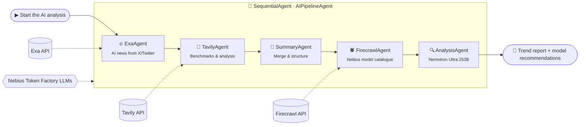

<div align="center">

# 🔍 AI Trend Research Agent

### Five AI agents. One sharp read on where AI is heading.

A **5-agent sequential pipeline** built with **Google's Agent Development Kit (ADK)**. It mines the latest AI news from X/Twitter, pulls live benchmark data, scrapes the Nebius Token Factory model catalogue, and hands everything to a **253B-parameter reasoning model**. That model writes trend analysis and makes **concrete model recommendations**.

[](https://tirth1263.github.io/AI-Trend-Research-Agent/)
[](https://google.github.io/adk-docs/)
[](https://www.python.org/)
[](LICENSE)

**[🌐 Try it live](https://tirth1263.github.io/AI-Trend-Research-Agent/)** · **[⚙️ How it works](#️-how-it-works)** · **[🚀 Quick start](#-quick-start)** · **[🎥 Explainer video](https://www.youtube.com/watch?v=FYhKah8FpAg)**

</div>

---

## ✨ Why this project?

AI moves fast. New models ship every week and benchmarks get rewritten overnight. Picking the *right* model for a job means reading Twitter threads, comparing leaderboards and digging through pricing pages.

**AI Trend Research Agent does that research for you in one run:**

- 🔥 **Catches what's trending.** It reads the last 30 days of AI launches and announcements on X/Twitter via **Exa** neural search.
- 📊 **Grounds it in data.** It pulls this week's benchmarks and provider analysis from **Artificial Analysis** via **Tavily**.
- 🕷️ **Knows what you can actually use.** It scrapes the **Nebius Token Factory** catalogue with **Firecrawl**, including models, context windows and pricing.
- 🧠 **Thinks it through.** **NVIDIA Llama-3.1-Nemotron-Ultra-253B** cross-references everything and tells you *which model to use and why*.

The output is a clean markdown report with trends, stats tables and model recommendations.

---

## 🌐 Live website

> **👉 [tirth1263.github.io/AI-Trend-Research-Agent](https://tirth1263.github.io/AI-Trend-Research-Agent/)**

The web edition runs the **same 5-stage pipeline in your browser**:

- 🔐 **Bring your own keys, no backend.** Keys go straight from your browser to each provider. They are only stored (in `localStorage`) if you tick *Remember*.
- ⚡ **Live streaming.** Watch each agent light up in the pipeline and stream its output token by token.
- 🎛️ **Model picker.** Load the models on your own Nebius account and swap the worker or analysis model.
- 📥 **Export.** Copy the final report or download it as `.md`.

> **Note:** Exa's API doesn't accept direct browser requests (CORS), so the web edition finds X/Twitter posts through Tavily (restricted to `x.com` / `twitter.com`) when that call is blocked. The Python ADK version calls Exa directly.

---

## ⚙️ How it works



ADK's `SequentialAgent` runs the agents in order. Each agent saves its answer into **shared session state** through its `output_key`. Later agents read those values through `{placeholders}` in their instructions, so no glue code is needed.

| # | Agent | Tool / data source | Model | Writes to state |
|---|-------|--------------------|-------|-----------------|
| 1 | 🔥 **ExaAgent** | `exa_search_ai`: Exa neural search over `x.com` / `twitter.com`, last 30 days | Llama-3.1-8B-Instruct | `exa_results` |
| 2 | 🐳 **TavilyAgent** | `tavily_search_ai_analysis`: Tavily advanced search on `artificialanalysis.ai`, last week | Llama-3.1-8B-Instruct | `tavily_results` |
| 3 | 🍥 **SummaryAgent** | reads `exa_results` + `tavily_results` | Llama-3.1-8B-Instruct | `final_summary` |
| 4 | 🕷️ **FirecrawlAgent** | `firecrawl_scrape_nebius`: scrapes tokenfactory.nebius.com to markdown | Llama-3.1-8B-Instruct | `firecrawl_content` |
| 5 | 🔍 **AnalysisAgent** | reads everything above | **Llama-3.1-Nemotron-Ultra-253B** | `analysis_results` |

**Design choices:**

- **Small model for plumbing, big model for thinking.** Tool calls and formatting run on a fast 8B model. Only the final reasoning step uses the 253B model, which keeps runs quick and cheap.
- **Graceful degradation.** Tools never raise. They return an `error` field, so one failing API doesn't sink the whole report.
- **Context hygiene.** Tool payloads are trimmed before they reach the LLM, so the model sees signal instead of 50k tokens of raw HTML.

---

## 🚀 Quick start

### 1. Clone the repo

```bash
git clone https://github.com/tirth1263/AI-Trend-Research-Agent.git
cd AI-Trend-Research-Agent
```

### 2. Install dependencies

```bash
# Using uv (recommended)
uv sync

# Or using pip
pip install -r requirements.txt
```

### 3. Set up environment variables

```bash
cp .env.example .env
```

Then edit `.env` with your API keys:

```env
NEBIUS_API_KEY="your_nebius_api_key_here"
NEBIUS_API_BASE="https://api.tokenfactory.nebius.com/v1"
EXA_API_KEY="your_exa_api_key_here"
TAVILY_API_KEY="your_tavily_api_key_here"
FIRECRAWL_API_KEY="your_firecrawl_api_key_here"
```

### 🔑 Required API keys

| Service | Used for | Get a key |
|---------|----------|-----------|
| **Nebius AI** | LLM inference (Llama 3.1 8B + Nemotron Ultra 253B) | [dub.sh/nebius](https://dub.sh/nebius) |
| **Exa** | AI news search on X/Twitter | [exa.ai](https://exa.ai/) |
| **Tavily** | Benchmarks & analysis search | [tavily.com](https://tavily.com/) |
| **Firecrawl** | Scraping the Nebius model catalogue | [firecrawl.dev](https://firecrawl.dev/) |

All four have free tiers, which are enough to run the pipeline.

---

## 🖥️ Usage

**ADK CLI**

```bash
# Terminal: run directly in the terminal
adk run analyzer_agent

# Dev UI: visual interface for testing and debugging (http://localhost:8000)
adk web
```

In either one, send any message (e.g. *"Start the AI analysis"*) to start the pipeline.

**Plain Python**

```bash
python main.py            # prints the final report
python main.py --verbose  # also prints every agent's intermediate output
```

**Docker** (full ADK web UI, ready for Cloud Run, Render, Railway or Fly.io)

```bash
docker build -t ai-trend-agent .
docker run -p 8000:8000 --env-file .env ai-trend-agent
```

---

## 🎛️ Configuration

| Variable | Default | Purpose |
|----------|---------|---------|
| `NEBIUS_API_BASE` | `https://api.tokenfactory.nebius.com/v1` | OpenAI-compatible Nebius endpoint |
| `NEBIUS_MODEL` | `meta-llama/Meta-Llama-3.1-8B-Instruct` | Model for agents 1–4 |
| `NEBIUS_ANALYSIS_MODEL` | `nvidia/Llama-3_1-Nemotron-Ultra-253B-v1` | Model for the AnalysisAgent |

If Nebius retires a model, change these variables. There's no need to touch the code.

---

## 📁 Project structure

```
AI-Trend-Research-Agent/
├── analyzer_agent/            # ADK agent package (what `adk run` / `adk web` load)
│   ├── __init__.py
│   ├── agent.py               # the 5 LlmAgents + SequentialAgent (root_agent)
│   └── tools.py               # Exa, Tavily and Firecrawl tool functions
├── web/                       # browser edition, deployed to GitHub Pages
│   ├── index.html
│   ├── style.css
│   └── app.js                 # same pipeline, client-side, streaming
├── .github/workflows/
│   └── deploy-pages.yml       # auto-deploys web/ on every push to main
├── main.py                    # one-shot CLI runner
├── Dockerfile                 # containerised ADK web UI
├── requirements.txt / pyproject.toml / uv.lock
└── .env.example
```

---

## 🧯 Troubleshooting

| Symptom | Fix |
|---------|-----|
| `404` / `model not found` from Nebius | The model was renamed or retired. On the website, use **Load my Nebius models**. In Python, set `NEBIUS_MODEL` / `NEBIUS_ANALYSIS_MODEL`. |
| An agent says its tool "failed" | Check that API key in `.env`. The pipeline keeps going with partial data. |
| Exa returns few results | Exa only covers the last 30 days of X/Twitter. Quiet news weeks give fewer hits. |
| `adk` command not found | Activate the virtual env (`.venv\Scripts\activate` on Windows, `source .venv/bin/activate` on macOS/Linux) or use `uv run adk web`. |

---

## 🛠️ Tech stack

**[Google ADK](https://google.github.io/adk-docs/)** (agent orchestration) · **[LiteLLM](https://github.com/BerriAI/litellm)** (model routing) · **[Nebius Token Factory](https://dub.sh/nebius)** (inference) · **[Exa](https://exa.ai/)** · **[Tavily](https://tavily.com/)** · **[Firecrawl](https://firecrawl.dev/)** · vanilla HTML/CSS/JS + GitHub Pages (website)

---

## 🙏 Credits

Based on the *Trend Analyzer Agent* from [Arindam200/awesome-ai-apps](https://github.com/Arindam200/awesome-ai-apps) and the [ADK Agent Examples](https://github.com/Astrodevil/ADK-Agent-Examples). Watch the original [explainer video](https://www.youtube.com/watch?v=FYhKah8FpAg).

## 📄 License

[MIT](LICENSE) © Tirth Rank

<div align="center">

**If this saved you an afternoon of tab-hopping, consider giving it a ⭐**

</div>
